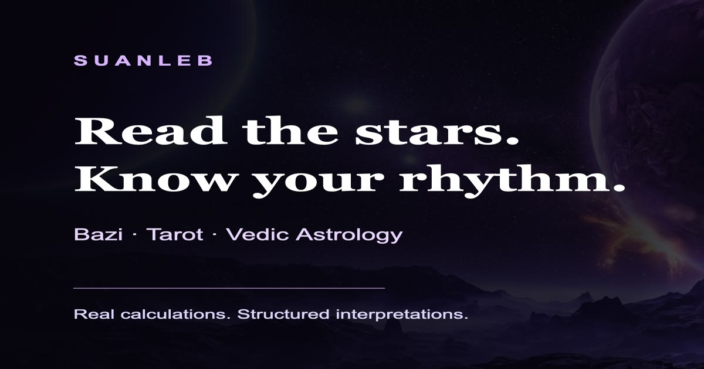

# Suanleb / 算了么 — Bazi, Tarot & Vedic Astrology

  

  <strong>Structured Bazi, Tarot and Vedic astrology readings with real calculations — official site <a href="https://suanlem.asia">suanlem.asia</a></strong>

  
  

**算了么（Suanleb）** is a bilingual digital lab for reflective readings: four-pillar **Bazi**, three-card **Tarot**, and **Vedic** sidereal astrology — with real calculation engines, historical validation, saved history, and a public methodology page. Product UI also offers personality-style reflection entry points.

> Readings are for **reflection and entertainment only** — not medical, legal, or investment advice.

## Links

| | URL |
|---|---|
| **App (official)** | https://suanlem.asia |
| **www** | https://www.suanlem.asia |
| **Pricing** | https://suanlem.asia/pricing |
| **Methodology** | https://suanlem.asia/methodology |
| **Disclaimer** | https://suanlem.asia/disclaimer |
| **This landing (GitHub Pages)** | https://maynor996.github.io/suanleb/ |

## Pricing (live, verified 2026-11-03 Asia/Shanghai)

| Plan | USD | CNY |
|------|-----|-----|
| Basic (monthly) | $2.93/mo | ¥19.9/mo |
| Pro (monthly) | $5.88/mo (list $8.82) | ¥39.9/mo (list ¥59.9) |
| Premium (yearly) | $44.03/yr | ¥299/yr |

Free Bazi / Tarot / Vedic entry points are available on the site. See https://suanlem.asia/pricing for the latest.

## What it does

- **Bazi** four-pillar charts with real calendar/astronomy inputs  
- **Tarot** three-card reflection spreads  
- **Vedic** sidereal charts (ayanamsha-aware)  
- Historical validation of life events, saved reading history, transparent methodology  
- Bilingual EN / 中文  

## Disclaimer

Readings are tools for reflection and entertainment only — **not** medical, legal, or investment advice. Official product URL: **https://suanlem.asia**.

Contact: bgnwd15@gmail.com
